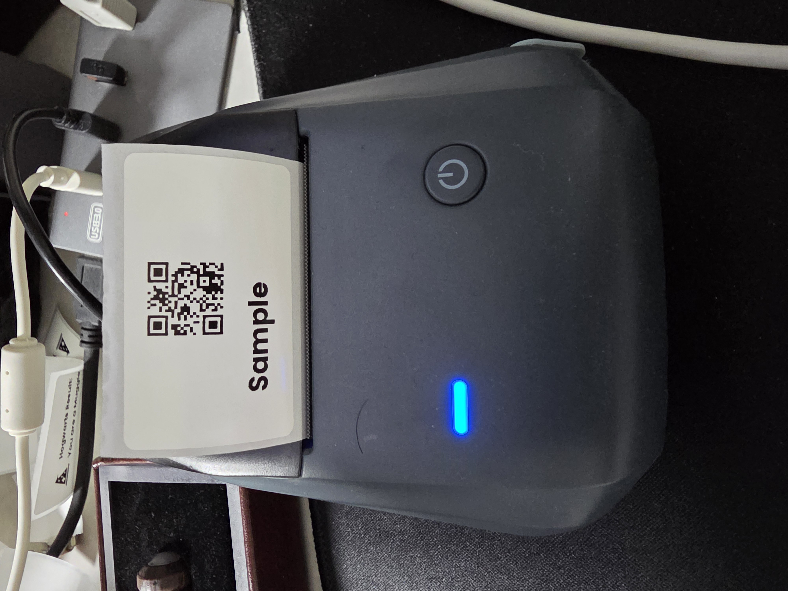
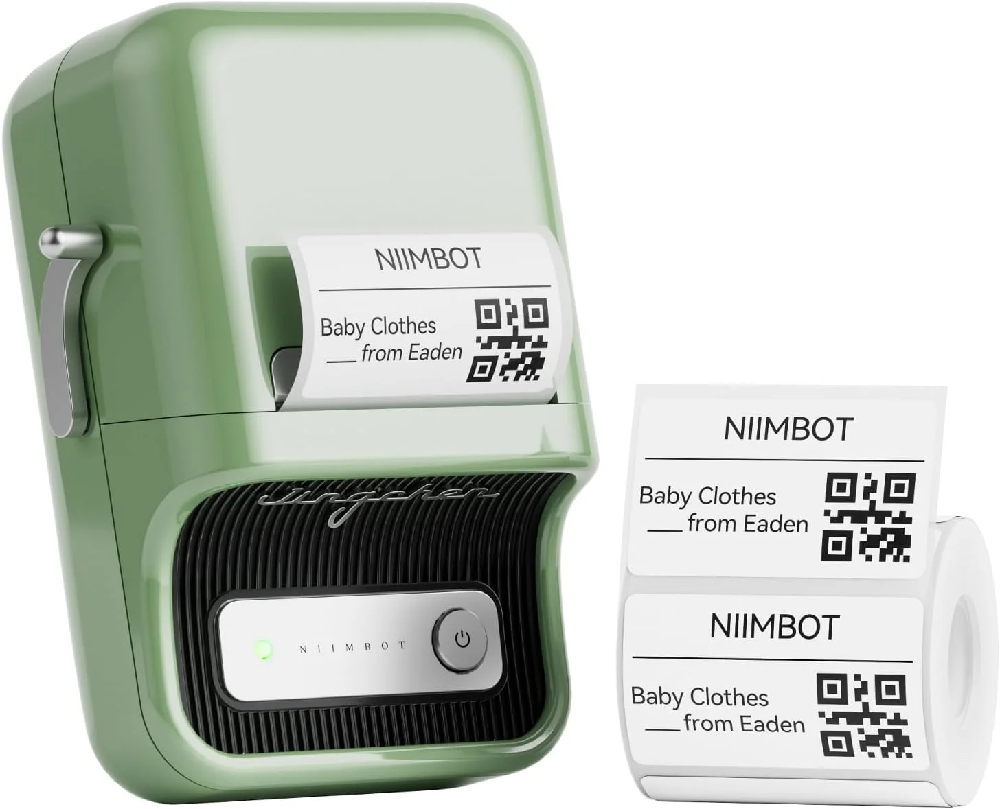
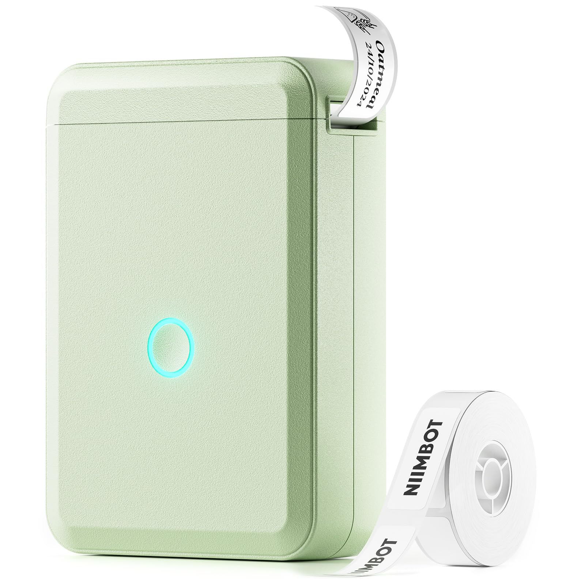

<!-- hass-standards:header:start -->
# hass-niimbot

Home Assistant에서 imagespec 페이로드를 Bluetooth로 전송하여 Niimbot 라벨을 인쇄하는 통합입니다.

[English](README.md) | **한국어**

<!-- hass-standards:badges:start -->
[](https://github.com/eigger/hass-niimbot/releases)
[](#설치)
[](hacs.json)
[](https://github.com/eigger/hass-niimbot/actions/workflows/tests.yml)
[](https://github.com/eigger/hass-niimbot/actions/workflows/validate.yml)
[](LICENSE)
[](https://www.hacs.xyz/)
<!-- hass-standards:badges:end -->
<!-- hass-standards:header:end -->

| B1 / B1 Pro | B21 Pro | D110 |
|---|---|---|
|  |  |  |

## 요구사항

HACS 기본 목록으로 배포하는 커스텀 통합입니다. Home Assistant **2025.1.0 이상**, **Python 3.13 이상**(기존 런타임 의존성의 요구 조건), 지원되는 Niimbot BLE 프린터와 HA에서 연결 가능한 Bluetooth 어댑터 또는 active ESPHome Bluetooth proxy가 필요합니다. Python 3.12로 실행하는 HA 2025.1 배포 환경에는 이 의존성 버전을 설치할 수 없습니다. 호환되는 Python 런타임이 필요하며 HA 지원 최소 버전 선언은 변경하지 않았습니다.

## 설치

<!-- hass-standards:installation:start -->
[](https://my.home-assistant.io/redirect/hacs_repository/?owner=eigger&repository=hass-niimbot)
<!-- hass-standards:installation:end -->

HACS를 먼저 설치·설정하세요. 위 배지는 HACS의 저장소 화면을 엽니다. HACS 기본 목록에서 **Niimbot**을 검색해 설치하거나 `custom_components/niimbot`을 HA 설정 폴더에 복사합니다. Home Assistant를 재시작하고 **설정 → 기기 및 서비스 → 통합구성요소 추가 → Niimbot**에서 발견된 프린터를 선택합니다.

프린터 전원을 켜고 절전 상태에서 깨운 뒤 NIIMBOT 휴대폰 앱의 연결을 종료하세요. [Bluetooth 프록시 설정](https://github.com/eigger/blesession/blob/main/docs/bluetooth.ko.md), [Niimbot 설정 (영어)](docs/setup.md#bluetooth-connection), [문제 해결](docs/troubleshooting.ko.md)을 확인하세요.

## 빠른 시작

통합 옵션에서 **Fetch Label Info Online**을 켜고 **Cloud Label Info** 조회가 성공하면 장착된 라벨 크기를 자동으로 사용합니다. **개발자 도구 → 액션**에서 프린터를 대상으로 다음 예제를 실행합니다.

```yaml
action: niimbot.print
target:
  device_id: <your device>
data:
  payload:
    - type: text
      value: Hello World!
      x: 10
      y: 10
      size: 28
```

[페이로드 안내](docs/payload.ko.md), [예제 모음 (영어)](examples/README.md), [액션 매개변수 (영어)](docs/actions.md), [imagespec 요소 참조 (영어)](https://github.com/eigger/imagespec/blob/main/docs/elements.md)에서 인쇄·자동화 예제를 확인할 수 있습니다.

## 주요 제한사항

대표 확인 모델은 B1, B1 Pro, B2 Pro, B21 Pro, D110입니다. 다른 모델·펌웨어는 동작이 다를 수 있습니다. 모델별 DPI, 크기, 회전, 농도와 자동 크기 우선순위는 [라벨 크기 안내 (영어)](docs/label-sizing.md), 전체 모델·용지 종류는 [기기 참조 (영어)](docs/devices.md)를 확인하세요.

온라인 라벨 조회는 기본적으로 꺼져 있습니다. 켜면 라벨 제품 바코드만 NIIMBOT 카탈로그에 전송합니다. 조회가 실패하면 크기를 직접 지정하세요. 기존 `400×240` px 기본값은 모든 라벨에 맞지 않습니다. BLE 전송 성공이 실제 인쇄 품질 검증을 뜻하지는 않습니다.

## 문서와 지원

- [문서 목록 (영어)](docs/README.md)
- [설정과 옵션 (영어)](docs/setup.md)
- [문제 해결](docs/troubleshooting.ko.md) ([English](docs/troubleshooting.md))
- [개발과 테스트 (영어)](CONTRIBUTING.md)
- [라이선스](LICENSE)
- [버그 제보](https://github.com/eigger/hass-niimbot/issues) · [질문·기능 제안](https://github.com/eigger/hass-niimbot/discussions)

HACS Downloads 배지는 HACS가 선택한 릴리스의 대상 asset 다운로드 수를 공식 HACS 데이터로 표시합니다. 전체 릴리스·모든 asset의 합계나 활성 설치 수가 아닙니다. 데이터 누락·조회 실패는 집계 확인 불가를 뜻하며 설치 수 0으로 해석하지 않습니다.

<!-- hass-standards:support:start -->
## 지원

- [Issues](https://github.com/eigger/hass-niimbot/issues): 버그를 신고하거나 기능을 요청하세요.
- [Discussions](https://github.com/eigger/hass-niimbot/discussions): 질문하고 사용 경험을 공유하세요.
<!-- hass-standards:support:end -->

<!-- hass-standards:related-projects:start -->
## 관련 프로젝트

- [imagespec](https://github.com/eigger/imagespec): 페이로드 렌더러와 요소 참조
- [niimblue](https://github.com/MultiMote/niimblue): Niimbot 프로토콜 구현
- [Stash](https://github.com/eigger/stash): Niimbot 인쇄를 지원하는 재고 관리 도구
<!-- hass-standards:related-projects:end -->

<!-- hass-standards:license:start -->
## 라이선스

[MIT License](LICENSE) 라이선스로 배포됩니다.
<!-- hass-standards:license:end -->
