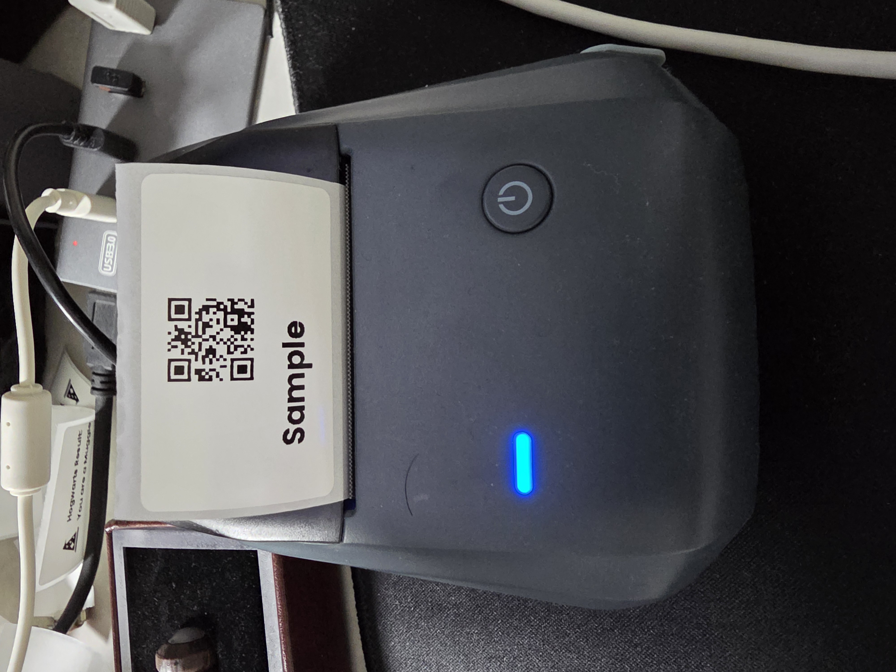
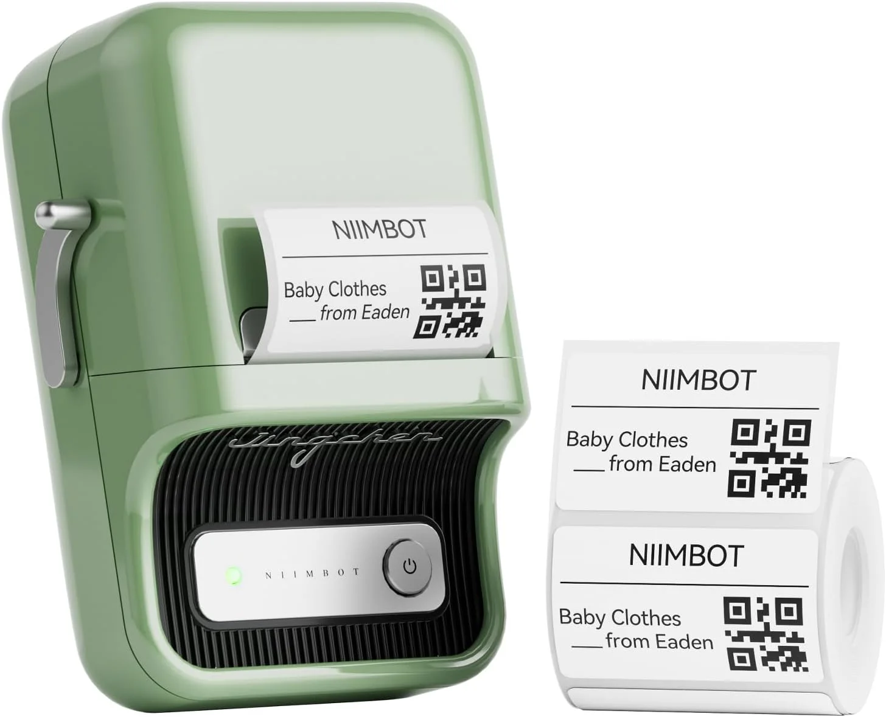
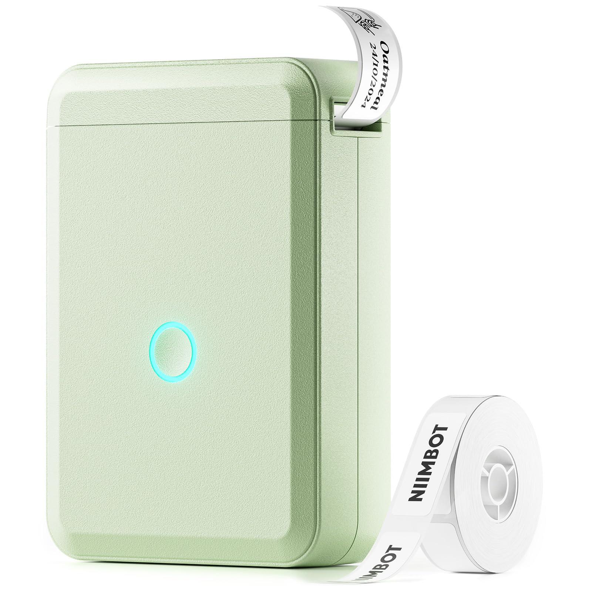

<!-- hass-standards:header:start -->
# Niimbot for Home Assistant

A Home Assistant custom integration that prints labels on Niimbot Bluetooth printers using imagespec layouts.

**English** | [한국어](README.ko.md)

<!-- hass-standards:badges:start -->
[](https://github.com/eigger/hass-niimbot/releases)
[](#installation)
[](hacs.json)
[](https://github.com/eigger/hass-niimbot/actions/workflows/tests.yml)
[](https://github.com/eigger/hass-niimbot/actions/workflows/validate.yml)
[](LICENSE)
[](https://github.com/eigger/hass-niimbot/releases)
<!-- hass-standards:badges:end -->
<!-- hass-standards:header:end -->

| B1 / B1 Pro | B21 Pro | D110 |
|---|---|---|
|  |  |  |

## Requirements

- **Home Assistant:** 2025.1.0 or later.
- **Python:** 3.13 or later for the existing runtime dependencies. Home Assistant 2025.1 installations using Python 3.12 need a compatible runtime.
- **Bluetooth:** A connectable Home Assistant Bluetooth adapter or an active ESPHome Bluetooth proxy.
- **Device:** A supported Niimbot BLE printer.

## Installation

<!-- hass-standards:installation:start -->
[](https://my.home-assistant.io/redirect/hacs_repository/?owner=eigger&repository=hass-niimbot)
<!-- hass-standards:installation:end -->

1. Click the badge above to open the repository in Marketplace.
2. If you need to add it yourself, go to **Settings → Marketplace → Add from link** and enter <https://github.com/eigger/hass-niimbot>. Connect GitHub if prompted.
3. Select **Install**. Restart Home Assistant if prompted, then continue to [Configuration](#configuration).

## Configuration

Turn the printer on, wake it and disconnect the NIIMBOT phone app. Select **Settings → Devices & services → Add integration → Niimbot** and choose a discovered printer.

See [Bluetooth proxy setup](https://github.com/eigger/blesession/blob/main/docs/bluetooth.md), [Niimbot setup](docs/setup.md#bluetooth-connection) and [troubleshooting](docs/troubleshooting.md).

## Quick start

Enable **Fetch Label Info Online** in the integration options to automatically use the loaded label's size after a successful lookup. Run this from **Developer tools → Actions** and replace the target with your printer:

```yaml
action: niimbot.print
target:
  device_id: <your device>
data:
  payload:
    - type: text
      value: Hello World!
      x: 10
      y: 10
      size: 28
```

See [payload guide](docs/payload.md) and [examples](examples/README.md) for more print and automation recipes. See [Actions](docs/actions.md) for parameters and [imagespec's element reference](https://github.com/eigger/imagespec/blob/main/docs/elements.md) for payload syntax.

<a name="important-limits"></a>

## Important limitations

B1, B1 Pro, B2 Pro, B21 Pro and D110 are the representative verified models; other models and firmware may behave differently. See [model settings and label sizing](docs/label-sizing.md) and the [full device reference](docs/devices.md).

Online label lookup is optional and off by default. When enabled, only the label product barcode is sent to NIIMBOT's catalogue. If lookup fails, specify dimensions explicitly: the legacy `400×240` px fallback does not fit every roll. A reported BLE success does not verify physical print quality.

<a name="documentation-and-support"></a>

## Documentation

- [Documentation index](docs/README.md)
- [Setup and options](docs/setup.md)
- [Troubleshooting](docs/troubleshooting.md) ([한국어](docs/ko/troubleshooting.md))
- [Development and tests](CONTRIBUTING.md)
- [License](LICENSE)
- [Report a bug](https://github.com/eigger/hass-niimbot/issues) · [Questions and feature requests](https://github.com/eigger/hass-niimbot/discussions)

<!-- hass-standards:support:start -->
## Support

- [Issues](https://github.com/eigger/hass-niimbot/issues): Report bugs or request features.
- [Discussions](https://github.com/eigger/hass-niimbot/discussions): Ask questions and share your experience.
<!-- hass-standards:support:end -->

<!-- hass-standards:related-projects:start -->
## Related Projects

- [imagespec](https://github.com/eigger/imagespec): payload renderer and element reference
- [niimblue](https://github.com/MultiMote/niimblue): Niimbot protocol implementation
- [Stash](https://github.com/eigger/stash): inventory manager with Niimbot printing support
<!-- hass-standards:related-projects:end -->

<!-- hass-standards:license:start -->
## License

Released under the [MIT License](LICENSE).
<!-- hass-standards:license:end -->
